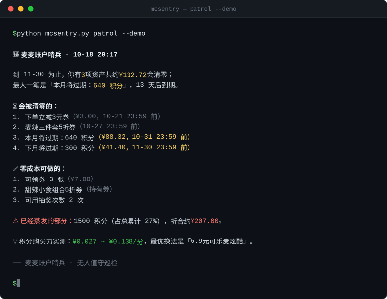

# 麦麦账户哨兵 · McAccount Sentinel

> **别人提醒你券要过期，我们直接帮你把券领了。**

零第三方依赖 · 默认只读 · 9 个麦当劳 MCP 工具 · 可直接进 cron



<sub>上图为 `--demo` 模式（构造数据）的排版演示；本文所有金额与比例均来自真实账户实测，可逐项复算。该图由 [`tools/make_readme_assets.py`](tools/make_readme_assets.py) 生成。</sub>

一个**无人值守**的麦当劳账户资产巡检系统。它每天自己醒来，把你名下所有会"过期蒸发"的东西——积分、券、抽奖次数、中奖未领的奖品——算清楚值多少钱、还有几小时清零，然后主动把"今天最该做的一件事"推到你面前。零风险的动作用它直接做完，有风险的动作等你一句话。

📄 [MCP 集成说明](MCP_INTEGRATION.md) · 🧾 [参赛声明](CONTEST_DECLARATION.md) · ⚙️ [MCP 配置示例](mcp-config.example.json) · 🚀 [快速开始](#六快速开始)

---

## 一、问题：不是用户不心疼，是没人在盯

这是实测时从一个真实麦当劳账户（`query-my-account` 原始返回）读到的数字：

| 指标 | 数值 |
|---|---:|
| 累计获得积分 | 778.5 |
| **已过期积分** | **758.5** |
| 过期占累计比例 | **97.4%** |
| 当前可用积分 | 0 |
| 已使用积分 | 20 |

按商城最优兑换率折算，**约 ¥104.67 已经蒸发了**。而这个账户的主人——大概率根本不知道这件事发生过。麦当劳不会发短信提醒你积分要清零，你也不会每天主动打开 App 查一遍。

券也一样：领了不用会过期，可领的没领就等于没有。这类损失的特点非常统一：

- **金额小、频次高**，不值得人专门去管
- **到期是持续的**，不是一次性事件
- **需要"记得"**，而人对"记得"这件事天生不可靠

所以问题不在于做一个更聪明的页面，而在于**有没有一个进程替你一直看着**。

---

## 二、与已有方案的差异：从「报告」到「代办」

账户到期这件事，市面上已经有不少"清单型"工具。它们的共同形态是：**用户主动打开 → 扫描一次 → 看一份报告 → 自己去操作**。

哨兵在三个维度上不同：

|  | 省钱/比价助手 | 到期清单工具 | **麦麦账户哨兵** |
|---|---|---|---|
| **触发方式** | 用户开口才响应 | 用户打开才运行 | **定时无人值守，自己醒来** |
| **关注对象** | 我该怎么花 | 我有哪些快过期 | **我快要损失什么** |
| **输出形态** | 建议 | 报告 | **已执行的动作为主，待确认的建议为辅** |
| **写操作** | 无 | 无 | **零风险动作自动做掉，有风险动作等你确认** |
| **触达位置** | 对话内 | 页面内 | **主动推出对话外（邮件/可插拔通道）** |
| **价值可量化** | 模糊"更省" | 模糊"快过期了" | **¥104.67，可复算** |

核心差异是**第三行和第四行**：`auto-bind-coupons` 是官方唯一一个"零成本、无交易、不可逆损失为零"的写操作。它让产品可以从"提醒"跨到"代办"——**这是清单型工具做不到、也不敢做的一步**。

一句话说清定位：

> 省钱助手回答「**我该怎么花**」，到期清单回答「**我快没了什么**」，
> 哨兵回答「**已经帮你办完了，还有三件需要你点头**」。

---

## 三、它每天做什么

```
① 校准     now-time-info              以服务器时间为准，不信本机时钟
② 发现     query-my-account           积分总量 / 本月·下月将过期积分 / 已过期
           query-my-coupons           已持有券 + 各自有效期
           available-coupons          可领未领的券
           query-lottery-info         剩余抽奖次数
           query-my-prizes            中奖未领取
           order-list                 消费节奏（判断账户是否活跃）
③ 估值     mall-points-products      用真实商品反推「1 积分值多少钱」
④ 排序     本地确定性计算             会被清零的优先，同组内按到期时间 + 金额排
⑤ 触达     可插拔通道                 邮件 / 文件 / 控制台
⑥ 可选执行 auto-bind-coupons          仅 --execute-claims 时触发
```

**关键设计原则：LLM 只负责把清单讲成人话，所有金额、排序、过期判定全部走确定性代码。** 这意味着：

- 每个数字都能追溯到某个工具返回或某一行商品数据
- 没有 LLM 也能跑（`python mcsentry.py patrol` 直接出报告）
- 不会出现"AI 编了一个 ¥37.5"

---

## 四、三个实测发现：为什么不能"直接把 MCP 串起来"

这是本项目最硬的部分。真实联调撞到三个坑，**任何一个都会让"简单串联"方案静默失败**。详细证据与修复见 [MCP_INTEGRATION.md](MCP_INTEGRATION.md#5-实测异常与处理核心工程价值)。

| # | 现象 | 后果 | 处理 |
|---|---|---|---|
| 1 | `available-coupons` 在"没有可领券"时必然报 `-32602`：schema 要求 `data` 是数组，服务端给的是 `null` | 空态被判为硬错误，巡检中断 | 绕过 structuredContent 校验，直读 `content[].text` |
| 2 | 积分券的 `price` 字段恒为 `"0"`，面额只写在商品名里（`"10.9元指定小食任选1份"`） | 整个积分商城样本被筛光，汇率永远算不出 | `price<=0` 时从 `spuName` 回退解析面额 |
| 3 | 同一 Server 混用三种响应形态：纯 JSON / **自然语言报告壳 + 内嵌 JSON** / 纯 Markdown | "找第一个括号"的解析法必然错位，且**静默返回空** | `raw_decode` 扫描所有起点，取最长可解码跨度 |

第 3 条尤其阴险：`mall-points-products` 的返回里，字段字典写着 `data[].spuName`，那个方括号出现在真正 JSON 之前。第一版解析器就栽在这里——它从 `data[]` 的 `[` 开始找，然后一路失败，最后安静地返回 `None`，报告上写着"未取得积分兑换汇率"，看起来像是账户没数据，实际是代码错了。

还有一个真实数据陷阱：商城里有 `status = 2`（上架）但 `downTime` 已经过期的商品。没有按时间窗过滤的话，会算出一个虚高的"最优汇率"——实测中那个 `¥0.188/分`（18.8元板烧两件套 / 100 积分）就来自一件 3 月已下架的商品。剔除后真实最优汇率回落到 `¥0.138/分`。

---

## 五、积分购买力实测：差 5 倍

同样一笔积分，换个兑换方式，价值相差 5 倍。这个数字是从商城真实商品算出来的，不是估算：

| 口径 | 元/积分 | 代表商品 |
|---|---:|---|
| 最优 | **0.138** | 6.9元香芋派/菠萝派任选（50 积分） |
| 常规（中位数） | 0.055 | — |
| 最差 | **0.027** | 21.9元巨无霸可乐组合（800 积分） |

基于 7 件当前可兑换商品计算。**这意味着：同样 800 积分，换 16 份派值 ¥110，换 1 份巨无霸组合只值 ¥21.9。** 大多数人从来没意识到自己的积分正在以最低效率被消耗——这也是哨兵报告里固定输出的一节。

---

## 六、快速开始

### 环境要求

- Python **3.9+**
- **零第三方依赖**（只有标准库）。不需要 `pip install`，可直接扔进 cron、CI 或任何裸机。

### 1. 申请 MCP Token

打开 <https://open.mcd.cn/mcp> → 右上角【登录】→ 手机号验证 → 【控制台】→ 点击【激活】→ 同意协议 → 复制 Token。

### 2. 配置 Token

推荐用环境变量：

```bash
export MCD_MCP_TOKEN="你的_token"
```

或在项目根目录建 `.env`（已被 `.gitignore` 忽略）：

```dotenv
MCD_MCP_TOKEN=你的_token
```

> ⚠️ Token 等价于你的账户身份，**不要提交到 Git**。仓库里只有 [`mcp-config.example.json`](mcp-config.example.json)，用的是 `${MCD_MCP_TOKEN}` 占位符。

### 3. 先跑演示（无需 Token，30 秒看到全貌）

```bash
python mcsentry.py patrol --demo
```

演示数据是**构造的**（见 `fixtures/demo_snapshot.json` 顶部说明），只有积分商城那一部分来自公开商城快照，目的是让估值可被复算。

### 4. 连通性自检

```bash
python mcsentry.py probe
```

会逐个工具打表，告诉你哪些能通、哪些返回了什么。**建议第一次跑这个**——如果你的账户状态特殊，先看真实返回再判断。

### 5. 真实巡检

```bash
# 简洁推送稿（适合手机通知预览）
python mcsentry.py patrol

# 完整 markdown 报告
python mcsentry.py patrol --full

# 同时落盘原始快照，便于核对每个数字的来源
python mcsentry.py patrol --json out/snapshot.json

# 写入 reports/ 目录，保留历史
python mcsentry.py patrol --push file --out reports
```

---

## 七、真实输出长什么样

以下是一份**真实账户**的巡检结果（`--full`，节选）：

```markdown
## 一句话结论

**当前没有即将过期的资产，但历史已蒸发 758.5 积分，折合约 ¥104.67——这个账户一直没有人在盯。**

## 二、已经流走的部分

| 指标 | 数值 |
|---|---:|
| 累计积分 | 778.5 |
| 账户可用积分 | 0 |
| 已过期积分 | 758.5 |
| 过期占累计比例 | 97.4% |
| 已蒸发价值（按最优兑换率估算） | ¥104.67 |

## 三、积分实际购买力（实测）

基于 7 件**当前可兑换**商品计算，1 积分的真实价值区间是 **¥0.027 ~ ¥0.138**。

| 口径 | 元/积分 | 代表商品 |
|---|---:|---|
| 最优 | 0.138 | 6.9元香芋派/菠萝派任选 |
| 常规（中位数） | 0.054 | — |
| 最差 | 0.027 | 21.9元巨无霸可乐组合 |

同样一笔积分，兑换方式不同，价值最多相差 **5.0 倍**。
```

而推送稿（`render_push`）是手机上能一眼看完的长度：

```
🍟 麦麦账户哨兵 · 10-18 19:10

到 11-30 为止，你有 3 项资产共约 ¥132.72 会清零；
最大一笔是「本月将过期：640 积分」，13 天后到期。

⏳ 会被清零的：
1. 下单立减3元券（¥3.00，10-21 23:59 前）
2. 本月将过期：640 积分（¥88.32，10-31 23:59 前）
   640 积分将在 10-31 到期清零，按最优兑换率折合约 ¥88.32

✅ 零成本可做的：
1. 可领券 3 张（¥7.00）
   领取零成本、零风险
2. 可用抽奖次数 2 次

⚠️ 已经蒸发的部分：1500 积分（占总累计 27%），折合约 ¥207.00。
💡 积分购买力实测：¥0.027 ~ ¥0.138/分，最优换法是「6.9元可乐麦炫酷」。
```

> 排序规则是刻意的：**「会被清零」永远排在「零成本可做」前面**。因为前者是损失，后者只是错过。只按"紧迫度"混排会让一张明天到期的 ¥3 券排在一笔两周后清零的 ¥88 积分前面——技术上没错，实际毫无用处。

---

## 八、接到 WorkBuddy：让巡检自己发生

哨兵的价值在"无人值守"，所以推荐两种接入方式。

### 方式 A：WorkBuddy 定时任务（推荐，零运维）

在 WorkBuddy 里创建一个每日定时任务，提示词直接用：

```text
执行麦麦账户哨兵巡检：在项目目录运行 `python mcsentry.py patrol --json out/snapshot.json --push email`，
然后把生成的一句话结论和"会被清零的"前三项读给我听。
如果发现 12 小时内到期的资产，直接告诉我最该做的那一件事。
不要执行任何下单、抽奖或兑换操作。
```

WorkBuddy 负责定时唤醒、调用 MCP 工具、把结果推给你；哨兵的 Python 代码负责其中所有确定性计算。两者分工清晰。

### 方式 B：cron（无 AI 也能跑）

```cron
# 每天 09:10 巡检，报告落到 reports/ 并发邮件
10 9 * * * cd /path/to/McSentry && /usr/bin/python3 mcsentry.py patrol --push email >> patrol.log 2>&1
```

### 推送通道

| 通道 | 状态 | 说明 |
|---|---|---|
| `console` | ✅ 默认 | stdout，适合 CI 与手动查看 |
| `file` | ✅ | 写入 `reports/*.md`，保留历史 |
| `email` | ✅ | SMTP，配置见 `sentry/pushers/email.py` 顶部 |
| 企业微信 / Webhook / 公众号 | 🔌 可插拔 | 实现 `Channel` 子类即可，约 15 行 |

> **关于「推到个人微信」的说明**：WorkBuddy 连接器市场与主流 MCP 生态中，目前**没有**官方提供的"个人微信号主动推送"连接器（公众号推文类能力推的是草稿箱，不是私聊）。因此本项目不承诺这个能力，而是把通道做成可插拔接口，默认用**邮件**——它在任何裸机 cron 上都能工作，不依赖任何机器人授权。这是刻意选择：宁可交付一条真能跑的链路，也不写一个演示时打不出来的功能。

---

## 九、安全边界

| 边界 | 做法 |
|---|---|
| **默认只读** | `patrol` 不加参数时只调 8 个只读工具，不改账户任何状态 |
| **写操作需显式开关** | 必须传 `--execute-claims` 才会调 `auto-bind-coupons` |
| **只自动化零风险动作** | 领券不花钱、不下单、不产生交易；`create-order` / `draw-lottery` / `mall-create-order` **永不自动执行**，只作为建议出现 |
| **写入前二次校验** | 先确认本次快照 `claimable` 非空，避免空跑 |
| **演示模式禁写** | `--demo` 下 `source != live`，直接跳过真实领券 |
| **Token 脱敏** | 日志中显示为 `1jCP****sluY`；报告产物中**绝不出现** Token 或 `accountId` |
| **单用户设计** | Token 是个人身份，哨兵只能在**本人账户、本人机器**上运行。不做多租户、不做代他人巡检 |

---

## 十、项目结构

```
McSentry/
├── mcsentry.py                 # CLI 入口：patrol / probe / version
├── sentry/
│   ├── mcp_client.py           # 零依赖 MCP 客户端（Streamable HTTP + JSON-RPC）
│   ├── config.py               # Token 解析与脱敏
│   ├── collect.py              # 9 个工具 → 带溯源信息的快照
│   ├── normalize.py            # 三种响应形态的归一化
│   ├── valuate.py              # 汇率推导 / 估值 / 排序（纯确定性）
│   ├── report.py               # 长报告 + 推送稿两种渲染
│   └── pushers/                # 可插拔推送通道
│       ├── base.py  console.py  file.py  email.py
├── fixtures/demo_snapshot.json  # 演示数据（构造，见文件内说明）
├── MCP_INTEGRATION.md          # MCP 调用说明与实测异常
├── CONTEST_DECLARATION.md      # 参赛声明（官方原文，未改动）
├── mcp-config.example.json     # 脱敏配置示例
├── SKILL.md                    # WorkBuddy Skill 定义
└── workbuddy.md                # WorkBuddy 开发上下文记录
```

---

## 十一、已知限制（诚实清单）

| 限制 | 说明 |
|---|---|
| **非空券列表的格式未实测** | 测试账户券列表为空，`query-my-coupons` 我只观测到"暂无可用优惠券"这一种返回。解析器按通用 markdown 表格实现，**无法解析时会把原文完整保留在报告里**，不做猜测。这是一个已知的待补样本点 |
| **抽奖次数重置规则未暴露** | `query-lottery-info` 只给 `availableTimes`，不给"何时重置"。所以报告只说"剩余 N 次"，**不编造"本周日重置"这类说法** |
| **积分汇率随商城变动** | 汇率来自当前在售商品，属于**估算口径**，报告里明确标注"按最优兑换率估算"。真实价值以你实际兑换到的商品为准 |
| **仅覆盖中国大陆** | 麦当劳 MCP 服务本身限定中国大陆地区（不含港澳台） |
| **金额为 0 的资产不折算** | 面额无法从券名解析出的券（如"5折券"），只做时间提醒，不编造金额 |
| **未实现下单级闭环** | 有风险的动作（核价、下单、抽奖）仅产出建议。这是安全边界，不是能力缺失 |

---

## 十二、目标用户

- **高频麦门用户**：每周下单 2 次以上，积分和券有实质积累，但从不主动管理
- **企业/团队里的"代买人"**：经常帮同事拼单，券和积分流转快，最容易漏
- **有"优惠券焦虑"但没时间管的人**：知道会浪费，就是记不住
- **想让 WorkBuddy 真正"自己干活"的开发者**：拿本项目当"定时任务 + MCP + 主动触达"的参考实现

不太适合：几乎不在麦当劳消费的账户（没有资产可守护，会天天收到"账户健康"的空报告）。

---

## 十三、关于本次参赛

本项目参加 **麦当劳程序员创意开发大赛**（2026-10-09 ~ 2026-10-25），基于麦当劳中国 MCP Server 开发。

- 使用 WorkBuddy 完成创意构思、MCP 联调、异常定位与代码实现，开发上下文见 [`workbuddy.md`](workbuddy.md)
- 项目为参赛者独立开发，**非麦当劳官方产品**
- 所有金额均由实测数据推算，不构成任何专业建议；餐品、券与积分的实际规则以麦当劳官方渠道为准
- 完整条款见 [`CONTEST_DECLARATION.md`](CONTEST_DECLARATION.md)

## License

[MIT](LICENSE)
